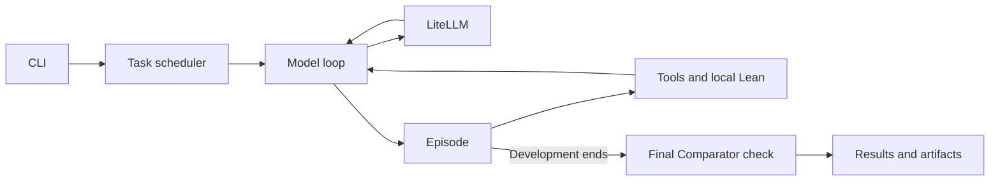

# DVP Architecture

[Back to documentation](README.md)

Each proof attempt has one model conversation and workspace. Batch evaluation runs independent attempts concurrently.

## Where to Read the Code

| Responsibility | Entry point |
| --- | --- |
| Single proof / batch evaluation | [`cli/prove.py`](../src/dvp/cli/prove.py), [`orchestration/evaluator.py`](../src/dvp/orchestration/evaluator.py) |
| Construct clients, tools, and verifiers | [`factory.py`](../src/dvp/factory.py) |
| Model loop and history | [`agent/driver.py`](../src/dvp/agent/driver.py), [`agent/messages.py`](../src/dvp/agent/messages.py) |
| State, budgets, and termination | [`agent/episode.py`](../src/dvp/agent/episode.py) |
| Prompts and tool feedback | [`agent/prompts.py`](../src/dvp/agent/prompts.py), [`agent/result_projection.py`](../src/dvp/agent/result_projection.py) |
| Model requests and response parsing | [`llm_clients/client.py`](../src/dvp/llm_clients/client.py), [`llm_clients/parser.py`](../src/dvp/llm_clients/parser.py) |
| Tool schemas and execution | [`toolkits/schemas.py`](../src/dvp/toolkits/schemas.py), [`toolkits/registry.py`](../src/dvp/toolkits/registry.py) |
| Compiler feedback / final acceptance | [`verification/lean.py`](../src/dvp/verification/lean.py), [`verification/comparator.py`](../src/dvp/verification/comparator.py) |
| Original obligations and local modules | [`verification/fixed_context.py`](../src/dvp/verification/fixed_context.py), [`verification/modules.py`](../src/dvp/verification/modules.py) |
| Datasets and workspaces | [`tasks/dataset.py`](../src/dvp/tasks/dataset.py), [`runtime/workspace.py`](../src/dvp/runtime/workspace.py) |
| Retries, resume, and scoring | [`orchestration/`](../src/dvp/orchestration/) |
| Saved conversations and results | [`artifacts/`](../src/dvp/artifacts/) |

## Call Relationships



`ProverDriver.run_rollout()` handles generation and tool feedback.
`ProverEpisode.step()` executes each action and updates state;
`finalize()` grades the saved sources after development stops.
Replay uses the same episode interface.

## Tools and Run Artifacts

The [README](../README.md#harness-design) lists the tools. Retrieval can be disabled;
Python requires explicit opt-in. Calls execute in order. Consecutive file writes
and edits defer compilation until the group ends, checking each changed Lean
destination once. See [editing](usage.md#editing-and-automatic-checks).

Model-visible results omit internal scoring and transport metadata. They remove
duplicate diagnostics and selected style warnings, shorten paths, and mark
truncated or omitted content. Full raw outcomes remain in the trajectory.
This presentation layer does not decide proof acceptance.

Batch output under `--run-root`:

| Path | Contents |
| --- | --- |
| `run_manifest.json` | Dataset, configuration, and source identity |
| `run_invocations.jsonl` | Initial and resumed launches |
| `execution_baseline.json` | Executed implementation and runtime identity |
| `summary.json`, `results.jsonl` | Aggregate progress and task results |
| `tasks/<task>/result.json` | Task-level result |
| `tasks/<task>/attempt_*/attempt_result.json` | Result for one attempt/retry |
| `tasks/<task>/attempt_*/conversation.json` | Model history and generation metadata |
| `tasks/<task>/attempt_*/trajectory.jsonl` | Detailed transitions and raw outcomes |
| `tasks/<task>/attempt_*/workspaces/` | Saved submission and helper files |
| `tasks/<task>/attempt_*/comparator_artifacts/` | Original/candidate sources, module bundle, logs, and verdict |

Use `--trace-level full` for all traces; `sft` saves the conversation only.
Single-proof runs use `--run-dir`, with `result.json` and artifacts directly inside it.
Check `valid_for_scoring` before treating a failed task as a mathematical rejection.
`pass@k` covers valid scored tasks; `success_rate_selected` covers all selected tasks.

## Behavior Contracts

- Development uses ordinary Lean compilation. A successful check does not submit the proof.
- A visible final reply or exhausted development limit ends generation. Empty responses, malformed calls, and truncated output have separate [recovery rules](usage.md#model-completion-and-tool-format-errors).
- Final acceptance rebuilds the saved entry and its local imports against the unchanged original. It runs once, outside model/tool budgets, with its own Lean timeout.
- Proof rejection and infrastructure failure are recorded separately. Final acceptance errors do not restart model generation.
- Comparator evidence binds the original task, candidate, and imported sources. Chat text, Python output, and earlier compiler results cannot substitute for acceptance.

See [verification](verification.md) for allowed axioms, runtime registration, and execution modes.

## Installation, Entry Points, and Paths

Install from source with `pip install -e .`. Commands use `dvp`; imports use `dvp.*`.
Lean helper programs in `verification/resources/` ship with the package.

| Directory | Purpose |
| --- | --- |
| `src/dvp/`, `tests/` | Implementation and tests |
| `benchmarks/` | Dataset files |
| `examples/`, `scripts/` | Portable settings, setup, and retrieval checks |
| `.local/` | Machine settings and launchers; ignored by Git |
| `runtime/`, `data/` | Installed runtimes and retrieval assets; ignored |
| `runs/`, `analysis/`, `logs/` | Generated results and reports; ignored |

Set `DVP_PROJECT_ROOT=/path/to/checkout` when launching outside the repository.
See [local configuration](local-configuration.md).

## Resuming Runs and Upgrading Fixed Contexts

`--resume` requires compatible task selection, model settings, services, and
implementation identity. Concurrency may change; changing the model endpoint
requires `--allow-endpoint-change`. Changes to proof execution, tools, or
verification require a new run directory. Each launch is recorded separately.

Datasets with fixed-context sidecars may need revalidation after an upgrade:

```bash
dvp prepare-contexts --activate \
  --dataset /absolute/path/to/tasks.jsonl \
  --target-workspace "$DAVINCI_TARGET_WORKSPACE" \
  --lean-timeout 3600
```

`--dataset` can be repeated. This validates original obligations and activates
metadata for the current implementation; it makes no model requests and does
not make an old run compatible with changed execution semantics.

## Validation

Run `python -m pytest -q`; see the [test guide](../tests/README.md) for groups and
dependencies. For behavior-preserving changes, compare model-visible messages,
tool results, saved sources, and verdicts using fixed-response replays. Measure
model performance separately with new evaluation runs.

See [release validation](release-validation.md) for recorded checks.

### Model client

The client wraps `litellm.acompletion` for provider conversion. DVP adds routing,
explicit sampling settings, bounded transient-error retries, and call metrics.
The OpenAI-compatible route uses an SDK client to control proxy settings and
preserve raw usage and malformed tool calls for error correction. There is no
automatic model fallback or context compression.
