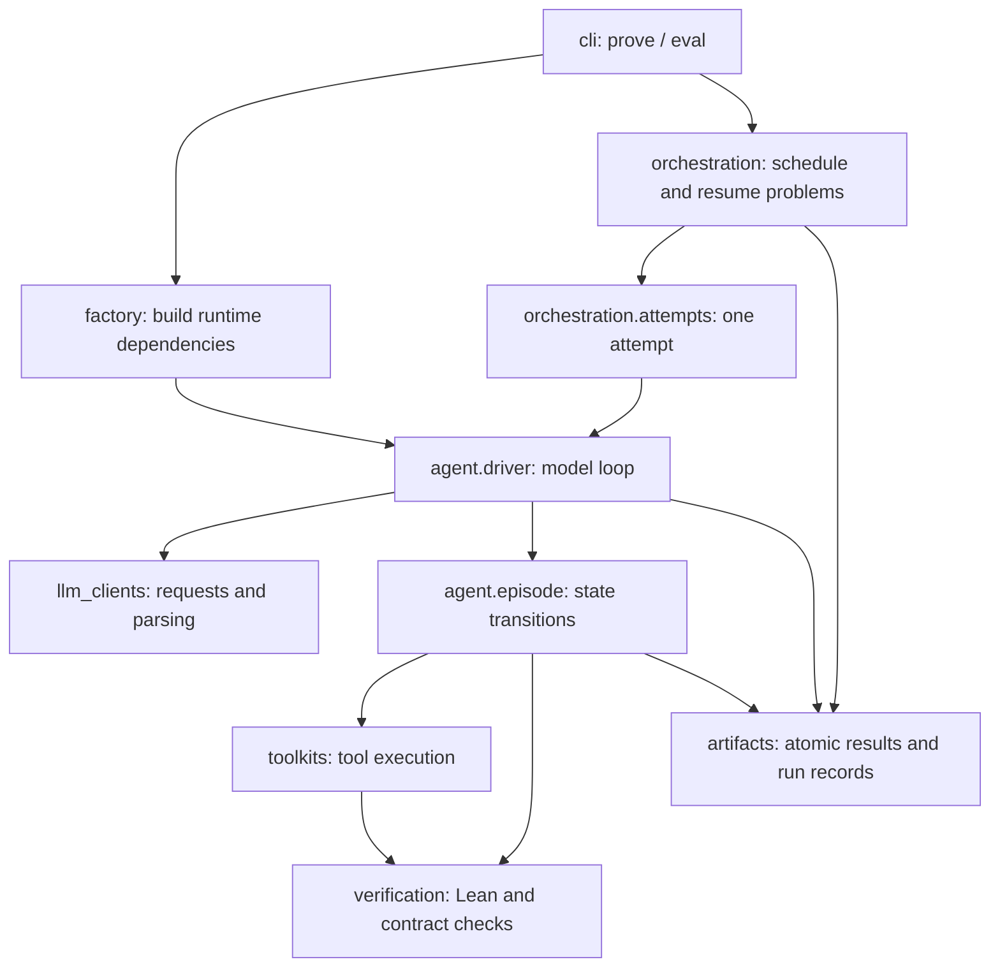

# DVP Architecture and Compatibility

DVP 0.7.0 is implemented in `src/dvp/`, organized by runtime responsibility: command entry points read arguments, the agent handles interactions for one problem, orchestration manages multiple problems, and tools and verifiers perform execution. The root `pyproject.toml` manages installation and commands; `tests/` contains behavior tests. See the [usage guide](usage.md#quick-start) for run instructions.

## Where to Read the Code

| Need | Entry point and responsibility |
|---|---|
| How a single problem starts | [`cli/prove.py`](../src/dvp/cli/prove.py) assembles arguments, services, the episode, and the driver, then saves single-problem artifacts |
| The model loop | `ProverDriver` in [`agent/driver.py`](../src/dvp/agent/driver.py) calls the model, processes replies, and advances the episode |
| State changes within a step | `ProverEpisode` in [`agent/episode.py`](../src/dvp/agent/episode.py) manages budgets, tool execution, feedback, and completion conditions |
| Prompts and message history | `agent/prompts.py`, `agent/messages.py`, and `agent/result_projection.py` separate prompts, message assembly, and model-visible results |
| Available tools and their execution | `ToolRegistry` in [`toolkits/registry.py`](../src/dvp/toolkits/registry.py) connects schemas, file tools, search, retrieval, and Lean tools |
| Trusted proof acceptance | `verification/lean.py` provides ordinary compilation feedback, `verification/fixed_context.py` identifies trusted original obligations, and `verification/comparator.py` performs final acceptance |
| Model interfaces and response compatibility | `llm_clients/client.py` and `parser.py` handle requests, HTTP retries, and action parsing |
| Concurrency and resume across problems | [`orchestration/evaluator.py`](../src/dvp/orchestration/evaluator.py) schedules tasks and coordinates the manifest, checkpoints, and progress publication |
| Converting input into tasks | [`tasks/dataset.py`](../src/dvp/tasks/dataset.py) loads JSON/JSONL and sidecars, preserves original row numbers, and applies problem selection criteria |
| Persisting files | `artifacts/persistence.py` writes results atomically; `conversation.py` and `trajectory.py` save two different kinds of traces |
| Assembling runtime dependencies | [`factory.py`](../src/dvp/factory.py) builds clients, workspaces, tools, and verifiers |
| Default paths | [`runtime/paths.py`](../src/dvp/runtime/paths.py) locates the project and installed package; `runtime/workspace.py` manages workspaces accessible to tools |

The `state`, `candidate`, `completion`, `outcomes`, and `guidance` modules in `agent/` handle state, candidates, completion evidence, tool results, and guidance respectively. `episode.py` retains the main state-transition flow; specific rules live in their respective modules. When changing a rule, also check its effects on model feedback, budgets, and termination decisions.

The Lean parser and draft-feedback programs in `verification/resources/` ship with the Python package. Compilation feedback uses local Lake/Lean, and final acceptance invokes the official Comparator. The default Mathlib workspace is `runtime/mathlib4-4.35`. This runtime directory is separate from the Python workspace-management code in `src/dvp/runtime/`. The old verification-service directory and workspace compatibility links have been removed. Update workspace paths in old commands or explicitly pass `--target-workspace`. Existing run records remain unchanged; their saved old workspace paths are no longer valid.

## Call Relationships



`config.py` and `protocol.py` provide shared configuration and serialization types. Tools do not manage evaluation retries or scoring denominators; verifiers do not call the model; the driver does not read datasets or resume evaluation directories. `factory.py` assembles concrete runtime dependencies so the CLI does not have to construct every tool itself.

The single-problem and batch entry points share runtime arguments from `cli/options.py`, configuration conversion through `episode_config_from_args()`, and construction through `factory.build_episode()`. Internal messages read only the defined fields of `Observation`, `Transition`, `ToolOutcome`, and `EpisodeResult`; legacy dictionary wrappers and aliases are no longer supported. The parser still handles native tool calls and DSML returned by model services.

Final descriptions and parameters for all seven tools are defined in `toolkits/schemas.py`. `surface.py` filters disabled capabilities and normalizes tool parameters, including default write paths and line ranges; the tool registry handles execution. JSONL retrieval retains its existing index loading and tokenization. The old index builder, which had no call entry point, has been removed.

Evaluation is split into the following modules:

| Module | Responsibility |
|---|---|
| `orchestration/config.py` | Convert CLI arguments into episode configuration |
| `orchestration/provenance.py` | Record the identity of the Python/Lean sources actually executed |
| `orchestration/manifest.py` | Create the run manifest and validate resume identity and execution baselines |
| `orchestration/checkpoints.py` | Validate complete results, select independent resume directories, and hold run locks |
| `orchestration/attempts.py` | Execute one proof attempt, distinguish proof failures from retryable faults, and aggregate results for one problem |
| `orchestration/results.py` | Maintain scoring denominators and output progress and final ordered results |
| `orchestration/evaluator.py` | Load selected problems, warm up fixed contexts, start a bounded number of workers, and publish results |

The CLI entry point `dvp.cli.evaluate` handles only arguments and startup; the scheduler only coordinates task execution. Data loading depends directly on `tasks.dataset`, and run identity depends on `orchestration.manifest`. Dedicated re-exports for old import paths have been removed.

## Tools and Run Artifacts

The model can use these seven tools. `--lean-retrieve false` hides and rejects `lean_retrieve`; the other six remain available.

| Tool | Purpose |
| --- | --- |
| `file_edit` | Replace text or a line range, or apply a validated batch across writable files. |
| `file_write` | Write `Submission.lean` or a file under `Submission/`. |
| `file_read` | Read workspace files with line ranges and pagination. |
| `file_search` | Find workspace files by glob pattern. |
| `content_search` | Search text or regular expressions and return matching lines with context. |
| `lean_retrieve` | Search indexed Lean declarations by name, natural language, or keywords. |
| `lean_verify` | Check a Lean file or inline probe together with its imported local modules. |

Consecutive `file_edit` and `file_write` calls in one response save in order, then each distinct changed `.lean` destination is checked once before another tool runs or the response ends. Each call validates its own edits; an invalid later call does not undo earlier saves. Final check results are attached once to the last successful save. Non-Lean files are saved without compilation. Explicit `lean_verify` calls and the total tool and Lean-check budgets remain available.

Automatic checks use ordinary local-module dependency verification for each destination, and each check may launch multiple Lean processes. Use `lean_verify` to recheck an unchanged importing target after helper-only changes. Drafts containing `sorry` or `admit` return local proof-hole feedback. See [editing and automatic checks](usage.md#editing-and-automatic-checks) for details.

Development checks return compiler feedback for ordinary and fixed-context tasks. Target-name recognition can describe proof progress, but never submits a candidate or invokes Comparator. After development stops, final acceptance reads the saved `Submission.lean` and asks Comparator to check the original target and all recorded obligations. See the [completion rules](verification.md#completion-and-termination).

Model-visible feedback uses relative workspace paths in compiler diagnostic locations, omits empty metadata, and avoids repeating identical retrieval explanations. Lean results carry one `check_kind: "compilation"` label per tool result, including grouped checks. Internal verification profiles and zero-count hole summaries are omitted; actual errors, positive hole counts, goals, and printed axiom dependencies remain available. Diagnostic bodies, line numbers, proof goals, and source text are preserved; oversized results retain omission or continuation information. Full original outcomes and acceptance evidence remain in the trajectory.

Development probes can import the saved `Submission.lean`, for example to run `#print axioms Namespace.target`. Source collection explicitly permits the root module only for these development bundles, rebuilds its full dependency closure, and binds the probe and each imported source to separate hashes. Cycles, missing sources, and symlinked modules are rejected. Final bundle collection and Comparator reconstruction keep their stricter entry rules; probe compilation never marks the target accepted.

Verifier feedback suppresses explicitly identified style lint (`unusedVariables`, `unusedSimpArgs`, `unnecessarySimpa`, `unusedSectionVars`, `unusedTactic`, and `style.haveILetI`) and duplicate warnings within the same check. Counts are reported as `linter_warnings_omitted` and `duplicate_warnings_omitted`. Unknown warnings, proof-placeholder and axiom/unsafe warnings, compiler errors, and hole goals remain eligible for display under the normal output budget. Console copies of the same diagnostics are removed as well. Filtering is stateless, applies to both ordinary and batch verification feedback, and never changes raw diagnostics or Comparator acceptance.

Comparator builds a fresh project containing the unchanged original task and unchanged submitted entry for every task. Local `Submission.*` imports form an immutable source bundle collected by `verification/modules.py`. Development checks and final acceptance compile that closure from source, without reusing local `.olean` files. Fixed-context metadata supplies original proof obligations and trusted axioms without rewriting the candidate. Candidates must include their own compilable context; omitted imports, definitions, and scopes are not restored. Development checks use ordinary Lean language rules, without additional keyword or command bans. Comparator remains responsible for rejecting changed statements, forbidden proof dependencies, and incomplete original obligations. Artifacts retain `Challenge.lean`, `candidate.lean`, `Solution.lean`, auxiliary sources, and a bundle manifest; evidence binds the original, entry, and complete dependency bundle. The official Comparator, permitted-axiom checks, and Lean kernel checks remain unchanged. Success requires exit code `0` and the `Your solution is okay!` marker; zero exit without that marker is an infrastructure error. Execution continues to use the selected DVP sandboxed or unsandboxed runtime.

Batch evaluation writes the following files under `--run-root`:

| Path | Contents |
| --- | --- |
| `run_manifest.json` | Dataset, configuration, environment, and implementation identities used for resume checks. |
| `run_invocations.jsonl` | Invocation records, including compatible resumed launches. |
| `summary.json` | Aggregate scores and current completion counts. |
| `results.jsonl` | Completed per-task results. |
| `tasks/<task-directory>/result.json` | One task's aggregate result across attempts and infrastructure retries. |
| `tasks/<task-directory>/attempt_<n>_retry_<r>/` | Artifacts for one attempt and retry slot; interrupted slots may use a `_resume_<n>` suffix. |

Each completed attempt saves `attempt_result.json`. Trace levels `sft` and `full` also save `conversation.json`; `full` additionally writes `trajectory.jsonl`. Final acceptance stores its evidence in `comparator_artifacts/`. Single-theorem runs use `--run-dir`, save `result.json` directly there, and place traces and Comparator artifacts alongside it.

Proof failures and infrastructure failures have different scoring meanings. Inspect `status` and `valid_for_scoring` before treating a zero score as a failed proof. `pass@k` uses valid scored tasks; `success_rate_selected` uses all selected tasks, including those without valid results. See the [usage guide](usage.md) for running evaluations and interpreting service failures.

## Behavior Contracts

Changes to directories, import paths, or class names must not incidentally change:

- CLI arguments and their precedence, current environment variables, or budget and sampling defaults. Run scripts set their own defaults, which must be checked alongside the actual CLI arguments.
- System prompts, tool names, schemas and order, tool-argument parsing, or the feedback the model actually receives. `conversation.json` saves the messages used by the driver; `trajectory.jsonl` saves more complete state and tool results. Neither replaces the other.
- File read/write boundaries, unchanged original/candidate sources, original target consistency, or Comparator rejection of incomplete proofs, new axioms, and native/compiler-trusted dependencies.
- Accepted turn counts, tool-call counts, Lean-call counts, or budget-exhaustion behavior. `terminated`, `truncated`, `aborted`, and `retryable_service_error` retain their distinct meanings.
- The distinction between independent attempts per problem and infrastructure retries, stopping at the first success, scoring eligibility, or statistical denominators. `pass@k` uses scored problems as its denominator; `success_rate_selected` uses all selected problems.
- The fields and reading conventions of result, conversation, trajectory, manifest, and other artifacts. Atomic writes protect individual result files. Per-problem results are the basis for resume; the root journal and summary can be rebuilt from them.

The package version is `0.7.0`. The current episode schema is `dvp.episode.v12`, which no longer emits duplicate result/diagnostic counts. The conversation schema is `dvp.conversation.v3`: rejected raw replies are saved in `rejected_responses`, separately from model-visible `messages`; actual per-call statistics remain in `generation_metadata.calls`. Output-truncation recovery keeps these schema versions. Historical run files are not rewritten.

The acceptance policy is `dvp.policy.comparator.v4`. Development and grading are separate: tools never invoke Comparator, and a successful target compilation does not terminate development. After a normal stop, an exhausted development or protocol-recovery limit, or a task timeout, finalization checks the saved `Submission.lean` and its imported source closure once. There is no preliminary Lean check or placeholder-free gate. Acceptance scores 1; rejection scores 0. Final acceptance timeouts or infrastructure exceptions are unscored infrastructure failures and do not restart model generation. Model/tool infrastructure aborts skip finalization and retain their existing retry rules; external cancellation propagates without background grading. Explicit independent attempts retain pass@k semantics. Use a new run directory: historical artifacts and scores remain unchanged.

Normal completion is handled inside `ProverEpisode.step`, shared by inference, replay, and RL. With no valid tool calls, `stop` plus visible text stops development on its first occurrence. DVP does not inject a completion-repair message or ask the model to continue. The visible response remains in history, while finalization grades the saved files independently. Valid parsed calls take priority over ordinary completion.

A thinking-only or empty normal response receives a reminder; another such response before a valid tool executes ends as `empty_response`. The observation records `empty_response_prompted`, which resets after at least one valid tool actually executes, including a Lean check that reports proof errors. Rejected or unexecuted calls do not reset it. A missing finish reason uses the normal-completion rules; malformed tool intent remains a format error. Valid parsed calls take priority over ordinary completion.

Standalone tool-call markup or an explicit JSON call envelope that cannot be parsed returns `tool_parse_error`, including when the provider reports `stop`. It consumes the existing consecutive-format-error allowance, not the empty-response reminder. The model receives corrective feedback; no call or argument is guessed from the damaged text. Native calls remain authoritative, and a `length` response keeps its separate truncation handling. Textual invocation batches must be complete before execution; malformed envelopes cannot execute embedded JSON or a fallback call from reasoning. Ordinary prose and quoted or fenced markup examples remain on the normal completion path. The current history policy removes rejected tool text from subsequent requests while retaining the raw response in the artifacts.

Prompt wording is separate from these completion rules. The default system prompt collects proof and submission requirements in one block, alongside workspace paths and the selected checking workflow. Tool descriptions explain operations, arguments, and results without repeating the submission requirements. Neither prescribes the first action or an order for reading, retrieval, and auxiliary proofs. Workflow guidance defaults to `off`; explicit `soft` mode retains the optional advisory hints. Protocol feedback identifies the error, reports which calls executed, and describes how to correct rejected calls. Truncation feedback asks for smaller steps using saved files and tool results. It does not discuss remaining task time or turns.

Local audits of Codex 0.146.0, Claude Code 2.1.235, and DeepSeek Harness 0.2.0-rc.2 informed the separation of development, normal completion, protocol recovery, and final grading. DVP still uses its own Chat Completions loop; it does not implement their native protocols or signed reasoning-block continuation. These changes have regression coverage, not a measured improvement in proof success rate.

A final chat response is not graded. `ProverEpisode.finalize` reads the saved entry and freezes its local imports; a previously successful inline probe or a proof mentioned in chat is not the submission. Final acceptance runs outside the development `--task-timeout`, with an independent `--lean-timeout`, and does not consume model turns or tool-call budget. It increments `lean_calls` once, which can exceed the development `--max-lean-calls` by one. The trajectory records grading as a harness action, not as a model-requested call in chat. No subsequent model request receives the final verdict. `rollout_reason` retains the development stop reason separately from the final grading `reason`. Both history policies use these rules.

Episodes limit consecutive format errors through `max_consecutive_format_errors`, exposed as `--max-consecutive-format-errors` in the CLI. The default is `3`; `0` disables this limit. Unknown tool names, malformed arguments unrelated to output truncation, missing calls despite a tool-call finish reason, unexpected finish reasons, and complete arguments that fail validation count once per model response. Multiple errors in one response do not increase the count further. A complete response with valid tool calls resets the count, even if a tool executes normally and then reports a Lean compilation or proof-check failure. Reaching the threshold stops development with `reason=repeated_format_error`. Finalization then grades the saved submission, so the protocol stop alone does not determine its score or cause an infrastructure retry. The current seven tools, `tool_choice=auto`, and Comparator acceptance retain their responsibilities; no `give_up` tool has been added.

Output-limit recovery is separate: `finish_reason=length` without a tool call, or with an incomplete tool-argument JSON payload, produces `output_truncated` rather than a format error. Pure truncation neither increments nor clears an unresolved format-error streak, preventing alternating truncation and format errors from bypassing the format-error limit. A complete valid tool call executes normally even when the finish reason is `length`; the marker alone does not invalidate it. Unknown tools and complete but schema-invalid arguments remain format errors. `max_consecutive_output_truncations`, exposed as `--max-consecutive-output-truncations`, defaults to `5`; `0` disables this guard while retaining all ordinary budgets. A complete response with valid tool calls resets the truncation streak. Reaching the truncation threshold stops development with `truncated=true` and `reason=repeated_output_truncation`. Finalization grades the saved submission; the truncation stop does not itself force a zero score or cause an infrastructure retry. Each truncated response still consumes a model turn and generated tokens.

Under the current history policy, genuine format errors remove the rejected assistant reply and return user-role corrective feedback. Normal thinking-only responses are likewise omitted from the next request, while their raw output remains archived. For output truncation, incomplete reasoning is omitted by default (`retain_truncated_thinking=false`), while visible partial text is retained. Explicitly setting the option to `true` retains useful incomplete reasoning, but a conservative repetition check still excludes an entire reasoning block if it contains at least 4,096 identical consecutive non-whitespace characters. This narrow check does not classify semantic repetition or ordinary long derivations. Retained reasoning becomes context in a new request; it is not native token-level continuation. Malformed tool calls are always stripped. Filtered raw replies are archived in `rejected_responses` with their one-based turn and error descriptions. Tool execution remains sequential; mixed valid/rejected batches report actual outcomes and executed valid arguments in the correction so workspace effects are not lost. Ordinary Lean failures and complete valid tool calls retain their assistant/tool messages, including associated reasoning. Visible normal final responses remain in history under either policy. The opt-in legacy policy retains its previous behavior.

Both consecutive-error thresholds and the retention option are included in episode configuration, artifacts, and the manifest's `episode` field, and contribute to `config_id`. These execution semantics require a new run directory after upgrading. Changing the settings on resume is rejected by the configuration identity check. See [Model Completion and Tool Format Errors](usage.md#model-completion-and-tool-format-errors).

Internal Python names are standardized by responsibility, such as `_build_user_prompt`, `_SYSTEM_PROMPT`, `_agent_source_identity`, and `_trusted_source_identity`, without aliases for old names. Run logs use `[dvp]`. These renamings do not automatically rewrite prompt text, persisted fields, or reserved names in the Lean validation protocol.

Model-facing prompts describe the workspace, development tools, proof requirements, and saved submission. They do not describe rewards, the number of acceptance attempts, or internal completion flags. Tool messages expose operation success, compiler diagnostics, draft goals, source placeholders, search evidence, and pagination. `success` describes that operation; successful draft compilation or an auxiliary lemma is not final acceptance. Internal `_harness` data, scoring, stop flags, and source-binding metadata remain in the full trajectory and drive finalization and acceptance. Before applying the output budget, verification feedback removes console blocks already present verbatim in its diagnostics and redundant primary-diagnostic message text. Error locations, selected goals, warnings, and distinct probe or process output remain available; actual truncation is marked. Full raw diagnostics remain in the trajectory. `lean_executed` is false for preflight rejection, true when execution is established, and null when the result cannot establish whether Lean started. Retrieval ranking and source text are unchanged; filtering episode scores does not remove relevance scores from retrieval hits.

The former saved-candidate completion recovery has been removed. A visible final response ends development immediately; only empty-output, tool-format, and truncation recovery remain. Optional `soft` guidance still supplies development suggestions; the default is `off`. A new evaluation run is needed to measure model-performance effects; existing trajectories are unchanged.

Only the current DVP tool surface is supported. Configuration, state, and manifests do not emit `action_surface`. Resume requires the manifest to contain complete source identity and artifact settings. It does not scan old task directories to infer trace types or accept runs missing this information. Checkpoint resume in the current format, concurrency changes, and execution identity validation remain supported.

Run manifests identify the controller as `dvp` and source components as `source.agent` and `source.trusted`. Execution baselines use `dvp.execution-baseline.v1`, with `agent_sha256` and `trusted_sha256`. The naming update requires a new run directory; historical artifacts are not migrated. The Lean parser uses `DvpCommandParser`, which changes its fingerprint and invalidates earlier prepared contexts. Rerun `dvp prepare-contexts` for datasets that include those contexts.

Verification uses only local Lake/Lean. Verification-service addresses, keys, remote-request logic, and startup scripts have been removed. Model-service interfaces remain unchanged. Drafts use a bundled local program to extract proof holes and local goals, with ordinary Lean compilation providing feedback. Final acceptance uses the official Comparator in separate original-problem and candidate projects; the old type probes and FixedContextGuard have been removed. The current integration uses `lake comparator` built into Lean 4.35.0. The default runtime uses a sandbox. An explicitly registered runtime with `execution_mode=unsandboxed` disables sandboxing for drafts, ordinary compilation, and final acceptance, and provides no sandbox isolation guarantees. The run manifest fingerprints the selected runtime files and prohibits resume across modes. Sandbox failures never automatically fall back to unsandboxed execution. See the README for installation. Source fingerprints have changed, so the current implementation requires a new run directory and cannot continue historical runs.

Subsequent tool-feedback improvements deliberately changed model input: complete multi-diagnostic feedback, file pagination that supports continued reading, enclosing parameters of retrieved declarations, and multiple source-search matches with context.
`file_read` gained `start_column`; `content_search` gained parameters for per-file match counts and context. Tool schemas and message baselines were updated accordingly.
These changes are separate from a directory-only refactor. The 29 fixed-response replays also keep independent execution baselines that check tool calls, contract checks, state events, final results, lifecycle errors, and workspace contents. Baseline updates require checking each authorized behavior change.
Fixed replays cannot establish that a real model will take the same actions. Changes in effectiveness require comparative evaluations in new run directories. See [LeanExplore](leanexplore.md#search-results-and-source-versions) for retrieval-result presentation and truncation rules.

The old proof-cache configuration, constructor parameters, and output fields, along with the agent's action-deduplication cache, have been removed. Repeated retrieval, source searches, and Lean checks of identical candidates execute every time and count toward tool and Lean-call budgets under the normal rules. Signatures, counters, and policy reminders for repeated diagnostics and repeated draft holes have also been removed; feedback from every actual diagnostic and draft hole is still returned normally. This does not disable the separate consecutive-tool-format-error termination rule above.

The inference service manages model-request prefix caching. The proof client requests worker session affinity with a fixed per-problem `X-SMG-Routing-Key` and saves server-reported token usage in `generation_metadata.calls` in `conversation.json`. These records do not change model history or tool execution. See [Distributed Inference and Prefix Caching](usage.md#distributed-inference-and-prefix-caching) for configuration and verification.

Tool registration and episode execution accept the seven core tools and optional `python_execute`. Historical submission entry points and removed Shell methods are no longer retained. Consecutive writes automatically compile each changed Lean destination once; `lean_verify` also supports explicit checks, and internal verifiers limit output length. Success is recorded only when Comparator accepts and the original-problem/candidate hash evidence matches; rejection records failure. The agent cannot modify the proof after acceptance completes. No submission tool has been added.

## Installation, Entry Points, and Paths

After activating the selected Python environment, install from the repository root:

```bash
python -m pip install -e '.[test]'
dvp prove --help
dvp eval --help
dvp prepare-contexts --help
dvp reverify --help
dvp parser --help
```

pip installs dependencies from `pyproject.toml`; `-e` installs DVP in editable mode without requiring `PYTHONPATH`. Local retrieval tests use `python -m pip install -e '.[lean-explore-local,test]'`. Repository scripts use `python` from the current `PATH` and do not create or switch environments. Python entry points locate the checkout automatically using the root `pyproject.toml`, `src/dvp/`, and `inputs/`. Set `DVP_PROJECT_ROOT=/path/to/checkout` to specify the directory containing data, retrieval assets, and Lean runtimes. If no checkout is found, the current directory is used. Parser subprocesses still import the same currently installed implementation.

Commands use `dvp` and Python imports use `dvp.*`. The `scripts/` directory contains Comparator setup, retrieval configuration checks, and server startup. Optional data-build helpers live in `tools/leanexplore/` and model diagnostics in `tools/diagnostics/`; see the [maintenance tools guide](../tools/README.md). Portable templates live in `examples/`; machine-specific endpoints, paths, and launchers belong in ignored `.local/`. The old `harness/` compatibility layer and old command aliases have been removed. After upgrading, reinstall from the root and update old imports and script paths.

When maintaining tests, monkeypatch the module where a function actually looks up its dependency. For example, evaluation's `build_services` and `build_episode` references should be patched in `dvp.orchestration.attempts`.

Datasets live in `inputs/`; fixed-context sidecars are stored beside their JSONL files. `data/` contains retrieval assets and rebuildable caches, `runs/` contains experiment artifacts, and `analysis/` holds local build and validation reports. These generated directories are not included in the source checkout. Directory cleanup does not automatically migrate paths in historical reports or saved experiments.

## Resuming Runs and Upgrading Fixed Contexts

Version 0.7.0 uses `dvp` source identity and recursively records Python implementation files and Lean resources. Newly added implementation files in deeper directories also contribute to identity.

**Runs from older versions cannot be resumed directly with the new version's `--resume`.** To continue an old experiment, use its original implementation and environment. Use a new output directory for the new version. Resume still locks the dataset, problem selection, model, sampling, episode configuration, service environment, and executed sources. Concurrency may change. Changing the model base URL requires explicit `--allow-endpoint-change`, which does not relax other identity checks.

A limited set of source changes in run entry points and the scheduler retain the runner-provenance exception. Changes to attempt execution, scoring, checkpoints, tools, verifiers, and other such modules remain part of the locked implementation. The original manifest remains unchanged; every invocation is written to `run_invocations.jsonl`.

Fixed-context `.contract.ready.json` files also contain implementation fingerprints. To revalidate and activate them after upgrading, run:

```bash
dvp prepare-contexts --activate \
  --dataset /absolute/path/to/tasks.jsonl \
  --target-workspace "$PWD/runtime/mathlib4-4.35" \
  --lean-timeout 3600
```

The command validates all fixed contexts in the explicitly specified datasets, then retains the old ready identity and publishes the new identity while preparing caches for the current implementation. Metadata identifies the original declarations and proof obligations; it does not authorize reconstructing a submitted file. Reverification now checks candidates as saved, so historical candidates that depended on omitted-context assembly must supply that context themselves. `--dataset` is required and can be repeated for multiple datasets. Inputs and sidecars must be adapted to the current environment beforehand. This process does not request the model or remove the source lock on old runs. See the [verification rules](verification.md#completion-and-termination) for validation boundaries.

## Validation

Structural refactors are validated through behavior comparisons, not file counts, line counts, or a single random model score.

1. Before changing anything, preserve the current working tree and run configuration, including uncommitted code and required resources. Retain known failures and assess them separately from issues introduced by the refactor.
2. Run the old and new implementations against fixed problems, model responses, tool requests, and tool responses. Compare messages, tool definitions, state, budgets, validation decisions, and output fields at every step. Normalize only timestamps, temporary paths, and random IDs explicitly known to have no semantic effect.
3. Cover successful proofs, proof failures, budget exhaustion, invalid tool arguments, infrastructure retries, partial-attempt resume, and corrupted checkpoints. Resume after interruption must not rerun completed tasks or score them twice.
4. Run the real parser, fixed-context checks, and final completion checks in the same Lean/Mathlib environment. Verify that validation resources ship with the installed package and that changes to deeply nested implementation files alter the source fingerprint.
5. Run a smoke test on a few problems using a real model and local Lean. Record which tests ran, were skipped, or failed. Passing tests does not prove complete equivalence for arbitrary inputs.

Run `python -m pytest -q` from the repository root to execute the current test configuration. `tests/orchestration/test_orchestration.py` provides deterministic regression coverage for retries, resume, scoring, atomic output, and source identity. Other unit and Lean integration tests jointly cover inference and verification behavior. See the [test guide](../tests/README.md) for the directory layout and commands. Some tests require Lean, Mathlib, Comparator, or optional Python dependencies; missing dependencies may cause skips or failures.

### Model client

`llm_clients/client.py` is a thin adapter around `litellm.acompletion`. LiteLLM owns
provider request/response conversion and error mapping. DVP retains task routing,
explicit generation settings, bounded transient-error retries, and per-call
metrics. The OpenAI-compatible path injects an upstream `AsyncOpenAI` client only
to configure proxy trust, transport lifetime, and a read-only response observer.
The observer preserves actual provider usage and malformed tool envelopes for
DVP's normal correction flow, even if SDK response normalization fails. There is no second HTTP model
backend, tokenizer probe, automatic context repair, or model fallback. Tool parsing
and actionable tool-error feedback remain in the agent layer. Normal assistant
history preserves reasoning and provider thinking/signature fields for SDK replay.
